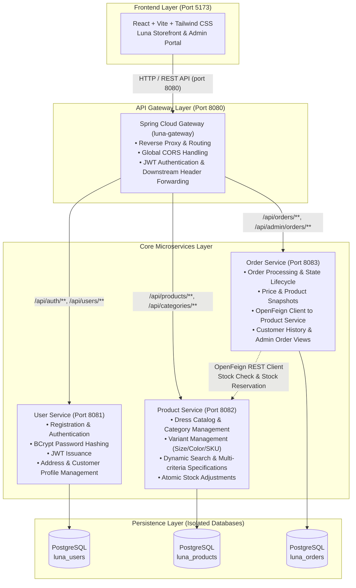
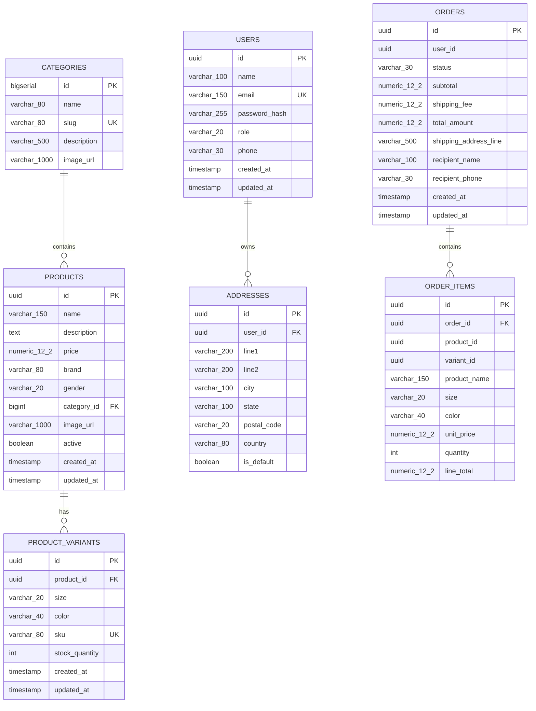
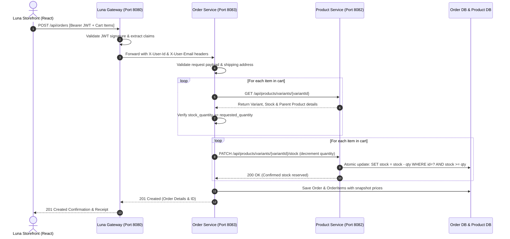
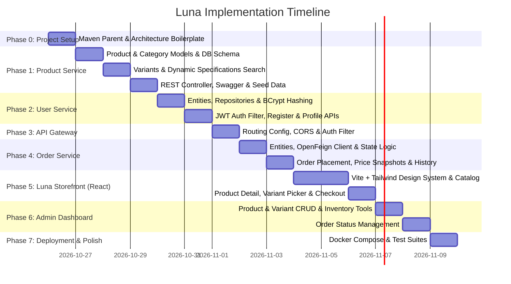

# Luna — Dress Shop E-commerce Microservices
## Comprehensive Master Implementation Plan & Architecture Blueprint

---

### Executive Summary

**Luna** is a production-grade, full-stack dress and fashion e-commerce platform built with modern microservices principles. Named for timeless elegance and chic modern style, **Luna** combines high-performance Java 21 / Spring Boot backends with an ultra-polished React + Vite storefront and admin dashboard. It is structured to demonstrate clean architectural patterns, strict database per service isolation, resilient REST communication, and interview-ready engineering standards.

---

## 1. System Architecture Diagram



---

## 2. Technology Stack & Compatibility Matrix

| Layer / Concern | Technology | Version / Specification | Rationale & Details |
| :--- | :--- | :--- | :--- |
| **Language** | Java | **Java 21 LTS** | Virtual threads readiness, Records, Pattern Matching, Modern switch |
| **Backend Framework** | Spring Boot | **3.3.x / 3.4.x** | Baseline LTS-compatible modern Spring framework |
| **API Gateway** | Spring Cloud Gateway | **2023.x / 2024.x BOM** | Non-blocking reactive gateway (Netty), unified entrypoint |
| **Service-to-Service** | Spring Cloud OpenFeign | **Compatible BOM** | Declarative HTTP client with resilience and error decoding |
| **ORM & Persistence** | Spring Data JPA / Hibernate 6 | Jakarta Persistence | Strict entity separation, Specification query builder |
| **Database** | PostgreSQL | **14+ / 16** | Robust transactional RDBMS with NUMERIC, UUID, and JSON support |
| **Security & Auth** | Spring Security 6 + JJWT | **0.12.x** | Stateless JWT authentication, RBAC (`CUSTOMER`, `ADMIN`) |
| **Validation** | Jakarta Bean Validation | Hibernate Validator | Strict request payload validation with `@Valid` |
| **API Docs** | Springdoc OpenAPI | **2.6.x** | Auto-generated Swagger UI for independent service exploration |
| **Frontend** | React 19 / 18 + Vite | Modern ECMAScript | Fast HMR, clean component tree, modular state hooks |
| **Styling** | Tailwind CSS | Modern Utility CSS | High-fashion editorial theme, custom color palette, responsive design |
| **Icons & HTTP** | Lucide React + Axios | Latest | Polished UI iconography, centralized Axios interceptors |
| **Deployment** | Docker Compose | Compose v2 | Isolated multi-container setup with healthchecks |

---

## 3. Database Schema & Data Isolation Model

Each microservice adheres strictly to the **Database-per-Service** pattern. No service ever performs a cross-database join or accesses another service's tables directly.



### Critical Data Design Rules:
1. **Prices & Monetary Values**: Always stored as `NUMERIC(12, 2)` and represented in Java as `java.math.BigDecimal` to eliminate floating-point rounding errors.
2. **Resource Identifiers**: Distributed UUIDs (`UUIDv4`) are used across services to eliminate cross-service coordination bottlenecks.
3. **Data Snapshots in Order Items**: `ORDER_ITEMS` stores explicit immutable copies of `product_name`, `size`, `color`, and `unit_price`. Any future changes to catalog pricing or dress details do not mutate previously placed orders.

---

## 4. End-to-End Request Flows

### A. Order Placement & Stock Reservation Flow



---

## 5. Phase-by-Phase Implementation Roadmap



### Phase 0: Maven Multi-Module Workspace Structure

Establish the root Maven multi-module aggregator and standard repository layout:

```text
luna/
├── pom.xml                        <-- Root parent pom with dependency management
├── docker-compose.yml              <-- Multi-container orchestrator
├── .env.example                    <-- Template for database and JWT credentials
├── README.md
├── luna-gateway/                   <-- Spring Cloud Gateway (port 8080)
│   ├── pom.xml
│   └── src/main/java/com/luna/gateway/ & resources/
├── user-service/                   <-- User & Auth Service (port 8081)
│   ├── pom.xml
│   └── src/main/java/com/luna/user/ & resources/
├── product-service/                <-- Product Catalog & Inventory Service (port 8082)
│   ├── pom.xml
│   └── src/main/java/com/luna/product/ & resources/
├── order-service/                  <-- Order Processing Service (port 8083)
│   ├── pom.xml
│   └── src/main/java/com/luna/order/ & resources/
└── frontend/                       <-- React + Vite + Tailwind CSS Luna Storefront (port 5173)
    ├── package.json
    ├── vite.config.js
    └── src/
```

- **Root `pom.xml`**: Defines Java 21, Spring Boot `3.3.x`, Spring Cloud `2023.0.x` dependency management, and aggregates the 4 backend modules (`com.luna.*`).

---

### Phase 1: Product Service (Port 8082) — *Immediate Focus*

1. **Step 1.1: Project Skeleton & Configuration**
   - Package: `com.luna.product`
   - Dependencies: `spring-boot-starter-web`, `spring-boot-starter-data-jpa`, `postgresql`, `spring-boot-starter-validation`, `spring-boot-starter-actuator`, `springdoc-openapi-starter-webmvc-ui`.
   - `application.yml`: Configured for port 8082, PostgreSQL `luna_products`, DDL update, and SQL formatting.
2. **Step 1.2: Domain Models & JPA Entities**
   - `Category`: `id`, `name`, `slug` (unique), `description`, `imageUrl`.
   - `Product`: `id` (UUID), `name`, `description`, `price` (`BigDecimal`), `brand` ("Luna"), `gender` (`MEN`, `WOMEN`, `UNISEX`), `category` (`@ManyToOne Category`), `imageUrl`, `active`, `createdAt`, `updatedAt`, `variants` (`@OneToMany`).
   - `ProductVariant`: `id` (UUID), `product` (`@ManyToOne`), `size` (`XS`, `S`, `M`, `L`, `XL`, `XXL`), `color`, `sku` (unique indexed), `stockQuantity`, timestamps.
3. **Step 1.3: DTOs & Domain Mappers**
   - Clean Java Records: `ProductRequest`, `ProductResponse`, `ProductDetailResponse`, `VariantRequest`, `VariantResponse`, `CategoryResponse`, `StockAdjustmentRequest`.
4. **Step 1.4: Dynamic Querying with JPA Specifications**
   - Filter criteria: text search (in name/description), category slug, gender, min/max price, variant size, and color.
   - Default sorting by `createdAt DESC` with pagination (`page`, `size`).
5. **Step 1.5: Inventory & Atomic Stock Rules**
   - Safe stock decrement:
     ```sql
     UPDATE product_variants SET stock_quantity = stock_quantity - :qty 
     WHERE id = :variantId AND stock_quantity >= :qty
     ```
   - Throw `InsufficientStockException` if rows affected == 0.
6. **Step 1.6: REST Controllers & OpenAPI Docs**
   - Public: `GET /api/products`, `GET /api/products/{id}`, `GET /api/categories`, `GET /api/products/{id}/variants`, `GET /api/products/variants/{variantId}`.
   - Admin/Internal: `POST /api/products`, `PUT /api/products/{id}`, `DELETE /api/products/{id}` (soft deactivation), `POST /api/products/{id}/variants`, `PATCH /api/products/variants/{variantId}/stock`.
   - Swagger UI accessible at `http://localhost:8082/swagger-ui.html`.
7. **Step 1.7: Error Handling & Realistic Seed Data**
   - RFC 7807 `ProblemDetail` via `@RestControllerAdvice`.
   - Data initializer seeding realistic Luna collections (Luna Silk Evening Dress, Velvet Cocktail Gown, Casual Floral Sundress, Classic Linen Midi, Tailored Blazer Dress) with diverse variants, sizes, colors, and high-resolution fashion imagery.

---

### Phase 2: User Service (Port 8081)

1. **Step 2.1: Domain & Security Layer**
   - Package: `com.luna.user`
   - `User` entity: `id` (UUID), `name`, `email` (unique), `passwordHash`, `role` (`CUSTOMER`, `ADMIN`), `phone`.
   - `Address` entity: `id` (UUID), `userId`, `line1`, `line2`, `city`, `state`, `postalCode`, `country`, `isDefault`.
   - `BCryptPasswordEncoder` for cryptographic password hashing.
2. **Step 2.2: JWT Token Provider & Filter**
   - Generate signed HMAC-SHA256 tokens carrying claims: `sub` (userId), `email`, `role`, `exp`.
   - Stateless `SecurityFilterChain` permitting `/api/auth/**` and protecting `/api/users/**`.
3. **Step 2.3: REST Endpoints**
   - `POST /api/auth/register`
   - `POST /api/auth/login`
   - `GET /api/users/me` (Profile details)
   - `PUT /api/users/me` (Update details)
   - `GET /api/users/me/addresses` & `POST /api/users/me/addresses`

---

### Phase 3: Luna API Gateway (Port 8080)

1. **Step 3.1: Route Configuration (`application.yml`)**
   - Package: `com.luna.gateway`
   - Forward `/api/auth/**` and `/api/users/**` -> `http://localhost:8081`
   - Forward `/api/products/**` and `/api/categories/**` -> `http://localhost:8082`
   - Forward `/api/orders/**` and `/api/admin/orders/**` -> `http://localhost:8083`
2. **Step 3.2: CORS & Global Filters**
   - Allow requests from `http://localhost:5173` with credentials, standard headers (`Authorization`, `Content-Type`), and HTTP methods (`GET`, `POST`, `PUT`, `DELETE`, `PATCH`, `OPTIONS`).
3. **Step 3.3: JWT Validation & Header Forwarding**
   - Gateway filter validating JWT signature and injecting downstream headers:
     `X-User-Id`, `X-User-Email`, `X-User-Role`.

---

### Phase 4: Order Service (Port 8083)

1. **Step 4.1: Domain Models**
   - Package: `com.luna.order`
   - `Order`: `id` (UUID), `userId`, `status` (`PENDING`, `CONFIRMED`, `SHIPPED`, `DELIVERED`, `CANCELLED`), `subtotal`, `shippingFee`, `totalAmount`, `shippingAddressLine`, `recipientName`, `createdAt`.
   - `OrderItem`: `id`, `orderId`, `productId`, `variantId`, `productName`, `size`, `color`, `unitPrice`, `quantity`, `lineTotal`.
2. **Step 4.2: OpenFeign Client Integration**
   - `ProductServiceClient` with fallback or error decoder for 404/400.
3. **Step 4.3: Order Placement Transaction Workflow**
   - Fetch variant details & ensure stock is sufficient.
   - Decrement stock atomically via Product Service.
   - Persist order record with price snapshots.
   - Cancel endpoint: allows user to cancel order if in `CONFIRMED` / `PENDING` status, triggering stock replenishment.
4. **Step 4.4: REST Endpoints**
   - Customer: `POST /api/orders`, `GET /api/orders` (authenticated user's orders), `GET /api/orders/{id}`, `PATCH /api/orders/{id}/cancel`.
   - Admin: `GET /api/admin/orders`, `PATCH /api/admin/orders/{id}/status`.

---

### Phase 5: Luna Storefront (React on Port 5173)

1. **Brand Identity & Aesthetic**:
   - Modern, high-end editorial boutique aesthetic (minimalist chic, warm slate / gold / pearl accents, elegant typography, glassmorphism, responsive navigation).
2. **Key Pages & User Flows**:
   - **Navbar**: Luna brand mark, links (Women, Men, Collections), live Cart drawer badge, User Account dropdown with role badge.
   - **Hero & Home**: "Luna Atelier" showcase, seasonal dress collections, curated category tiles.
   - **Shop / Catalog**:
     - Real-time search bar with debounce.
     - Multi-faceted filter sidebar: Gender, Categories, Size pills, Price range slider.
     - Product Grid with interactive cards, quick add, price, and category chips.
   - **Product Detail Page**:
     - High-res dress imagery.
     - Size & Color swatch selector.
     - Dynamic stock warning badge ("Only 2 left in stock!" or "Out of Stock").
     - Add to Cart action with micro-animations.
   - **Shopping Cart & Checkout**:
     - Slide-over cart drawer & full checkout page.
     - Address input/selection.
     - Order summary with itemized prices, shipping fee, and grand total.
     - Order confirmation modal with generated Order ID and delivery tracking timeline.
   - **Customer Account / My Orders**:
     - Historical order list with item snapshots, dates, status badges, and Cancel Order button.

---

### Phase 6: Luna Admin Dashboard

1. **Product Catalog Manager**:
   - Product list table with search, category filtering, and status toggle.
   - Create & Edit Product modal (Name, Description, Price, Brand, Gender, Category, Image URL).
   - Variant manager modal: Add sizes, colors, SKUs, and view stock.
2. **Inventory Stock Control**:
   - Quick inline stock editor: easily restock low-inventory variants.
3. **Order Fulfillment Hub**:
   - Real-time order list with customer name, total amount, timestamp, and status.
   - Quick action to advance status: `CONFIRMED` -> `SHIPPED` -> `DELIVERED` or `CANCELLED`.

---

### Phase 7: Containerization & Interview Preparation

1. **Docker Compose Setup (`docker-compose.yml`)**:
   - Single command `docker-compose up --build` spinning up:
     - PostgreSQL database(s) (`luna_products`, `luna_users`, `luna_orders`)
     - `product-service`
     - `user-service`
     - `order-service`
     - `luna-gateway`
     - `frontend`
2. **Java Developer Interview Discussion Points Guide**:
   - *Why Microservices over Monolith for Luna?* Clear business domain boundaries (Catalog vs User Auth vs Order fulfillment).
   - *How do we handle Distributed Transactions?* Explaining 2-Phase Commit vs Saga Pattern (Orchestration vs Choreography) and synchronous REST with compensating stock updates vs Event-driven with Kafka.
   - *Why Data Snapshots in Orders?* Catalog pricing changes must never retroactively alter financial history.
   - *Concurrency in Stock Management*: Preventing overselling using atomic conditional SQL updates (`WHERE stock >= requested`) vs Pessimistic/Optimistic locking.

---

## 6. Execution Milestones & Next Action

| Milestone | Deliverables | Verification Criteria |
| :--- | :--- | :--- |
| **M1: Foundation & Product Service** | Multi-module Maven setup (`com.luna.*`) + Product Service with Categories, Variants, Specifications Filter, and Seed Data | `mvn test` passes, `GET /api/products` returns seeded Luna dresses with variants in Postman & Swagger UI |
| **M2: User Service & Auth** | User Service with BCrypt, JWT generation, User registration/login & addresses | Register customer & admin; verify JWT in jwt.io |
| **M3: Gateway Routing & CORS** | Luna Gateway routing with CORS configured for port 5173 | Querying `/api/products` through port 8080 successfully forwards to 8082 |
| **M4: Order Service & Feign** | Order Service communicating with Product Service via OpenFeign, creating snapshot orders & deducting stock | Place order on 8083, verify variant stock decreased in 8082 |
| **M5: Luna Storefront** | Vite + Tailwind application with Catalog, Filter, Product Detail, Cart, and Checkout | End-to-end shopping journey functional in browser |
| **M6: Admin Portal** | Product/Variant CRUD and Order status update dashboards | Admin can add dresses and advance order status |
| **M7: Dockerization & Documentation** | `docker-compose.yml` and project README | Full stack launches cleanly via Docker |
