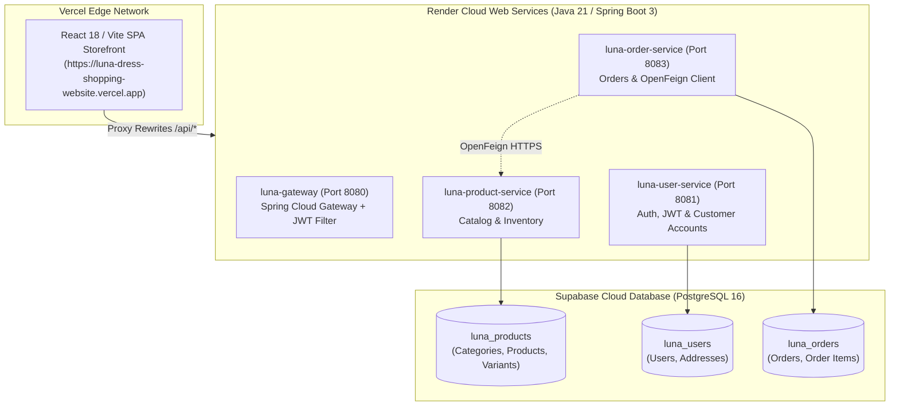

# L U N A — Post-Development Issues & Solutions Register

This document provides a comprehensive technical log of all architectural, deployment, database, security, and integration issues encountered after initial development of the **Luna — Haute Couture Dress Shop E-Commerce Microservices Platform**, along with the exact root causes, solutions implemented, and engineering takeaways.

---

## Architecture Overview



---

## Summary Matrix of Resolved Issues

| # | Domain | Issue Summary | Error Code / Symptom | Root Cause | Fix / Architectural Solution |
|---|---|---|---|---|---|
| **1** | Frontend / SPA | Blank screen crash on startup | `TypeError: e.slice(...).map is not a function` | Vercel catch-all rewrote `/api/categories` to `index.html` string | Axios HTML rejection interceptor + `Array.isArray()` guards |
| **2** | API Routing | 500 error on `/api/products` & `/api/categories` | `500 Internal Server Error` (UUID parse fail) | Vercel wildcard `:path*` appended trailing slash; Spring 6 matched `/{id}` | Rewrote `vercel.json` with exact match paths before `:path+` |
| **3** | Database | Supabase connection exhaustion | `PSQLException: FATAL (EMAXCONNSESSION) max 15` | 3 services x 10 default HikariCP connections = 30 > 15 limit | Capped HikariCP pools (`maximum-pool-size=3`, `minimum-idle=1`) |
| **4** | Microservices | 502 Bad Gateway during checkout | `502 Bad Gateway` on `POST /api/orders` | OpenFeign called unresolvable private hostname `http://luna-product-service` | Updated `PRODUCT_SERVICE_URL` to public HTTPS Render domain |
| **5** | Spring / Hibernate | Order service startup crash | `HibernateException: Unable to determine Dialect` | Hibernate failed live metadata check when DB was unreachable | Added explicit `PostgreSQLDialect` + `${DB_URL:${DATABASE_URL}}` fallbacks |
| **6** | Auth / Identity | Checkout rejected with missing header | `400 Bad Request: X-User-Id header missing` | Bypassing gateway meant no downstream `X-User-Id` injection | Added dual resolution: `X-User-Id` + JWT Bearer token fallback |
| **7** | Admin Catalog | Dress creation failed with 400 | `400 Bad Request` on `POST /api/products` | `ProductRequest` required `categorySlug`; form only passed `categoryId` | Made slug optional in DTO + added `resolveCategory()` by slug or ID |
| **8** | Security (IDOR) | Client identity spoofing risk | Potential unauthorized user impersonation | Client allowed to inject arbitrary `X-User-Id` | Enforced server/gateway JWT verification as single source of truth |
| **9** | SQL Schema | Variant name query error | `ERROR 42703: column product_name does not exist` | Querying variant table for product name in 3NF schema | Provided canonical relational `JOIN` query with parent `products` |
| **10** | Business Logic | Stock count discrepancy (65 vs 18) | Admin showed 65, product details showed 18 | Total dress inventory vs. variant-specific inventory | Clarified aggregated `totalStock` vs. selected SKU live stock |

---

## Detailed Issue Breakdowns

---

### Issue 1: Frontend Blank Screen Crash on Boot

#### Symptom & Error
When opening the Vercel production URL, the screen stayed completely blank and threw a React fatal error in the console:
```text
Uncaught TypeError: e.slice(...).map is not a function
    at Home (index-BD1JbTmY.js:362)
```

#### Technical Root Cause
The Single Page Application (SPA) routing in `vercel.json` configured a catch-all rewrite:
```json
{ "source": "/(.*)", "destination": "/index.html" }
```
Because `/api/categories` had no explicit upstream destination, Vercel served `index.html` (raw HTML string starting with `<!doctype html>`) with HTTP `200 OK`. 
Axios treated it as a successful response. The React component executed:
```javascript
categories.slice(0, 5).map(...)
```
Since `categories` was a string (`"<!doctype html..."`), `.slice(0, 5)` returned `"<!doc"`. Calling `.map()` on a string threw `TypeError` and unmounted the React root tree.

#### Solution Implemented
1. **Axios Response Interceptor** ([`frontend/src/services/api.js`](file:///Users/sanjaya/Documents/DressShoppingWebsite/frontend/src/services/api.js)):
   Added defense-in-depth to detect and reject HTML responses for API calls:
   ```javascript
   api.interceptors.response.use(
     (response) => {
       const contentType = response.headers?.['content-type'] || '';
       if (
         typeof response.data === 'string' &&
         (contentType.includes('text/html') || response.data.trim().startsWith('<!doctype'))
       ) {
         return Promise.reject(new Error('Received HTML response instead of JSON. Ensure API proxy is configured.'));
       }
       return response;
     },
     (error) => Promise.reject(error)
   );
   ```
2. **Defensive UI Guards & Skeletons** ([`frontend/src/pages/Home.jsx`](file:///Users/sanjaya/Documents/DressShoppingWebsite/frontend/src/pages/Home.jsx)):
   Replaced raw `.map()` calls with `Array.isArray()` guards and added shimmering skeleton placeholders while connecting to Render backend instances.

---

### Issue 2: Vercel Proxy Trailing Slash & Spring Boot 3 Route Mismatch

#### Symptom & Error
Direct calls to `/api/products` via the Vercel domain returned `HTTP 500 Internal Server Error`, while calling the backend Render URL directly worked:
```text
GET https://luna-dress-shopping-website.vercel.app/api/products -> 500 Internal Server Error
Caused by: java.lang.IllegalArgumentException: Invalid UUID string: ""
```

#### Technical Root Cause
1. `vercel.json` was using wildcards:
   ```json
   { "source": "/api/products/:path*", "destination": "https://luna-product-service.onrender.com/api/products/:path*" }
   ```
2. When `:path*` was empty, Vercel appended a trailing slash: `/api/products/`.
3. In Spring Boot 3 (Spring Framework 6.0+), **trailing slash matching is disabled by default** for RFC 3986 compliance and security.
4. As a result, `/api/products/` did not match `@GetMapping` on `/api/products`. Instead, it matched `@GetMapping("/{id}")`, passing an empty string `""` as `@PathVariable UUID id`, throwing `IllegalArgumentException`.

#### Solution Implemented
Updated [`frontend/vercel.json`](file:///Users/sanjaya/Documents/DressShoppingWebsite/frontend/vercel.json) to separate exact root matches from subpaths with `:path+`:
```json
{
  "source": "/api/products",
  "destination": "https://luna-product-service.onrender.com/api/products"
},
{
  "source": "/api/products/:path+",
  "destination": "https://luna-product-service.onrender.com/api/products/:path+"
}
```
This preserved clean, canonical Spring Boot controllers without resorting to anti-pattern `@GetMapping({"", "/"})` workarounds.

---

### Issue 3: Supabase Session Pooler Exhaustion (`EMAXCONNSESSION`)

#### Symptom & Error
All backend microservices failed on boot or during database interaction with:
```text
org.postgresql.util.PSQLException: FATAL: (EMAXCONNSESSION) max clients reached in session mode - max clients are limited to pool_size: 15
```

#### Technical Root Cause
1. Supabase's hosted PostgreSQL free-tier pooler on port `5432` has a hard limit of **15 active client connections**.
2. Spring Boot's default connection pooler (HikariCP) allocates **10 connections per instance**.
3. With 3 microservices (`product-service`, `user-service`, `order-service`), the fleet requested $3 \times 10 = 30$ connections, instantly exceeding the 15-connection threshold and locking the database.

#### Solution Implemented
Configured explicit HikariCP pool caps in `application.properties` across all three services ([`product-service`](file:///Users/sanjaya/Documents/DressShoppingWebsite/product-service/src/main/resources/application.properties#L12-L15), [`user-service`](file:///Users/sanjaya/Documents/DressShoppingWebsite/user-service/src/main/resources/application.properties#L12-L15), [`order-service`](file:///Users/sanjaya/Documents/DressShoppingWebsite/order-service/src/main/resources/application.properties#L12-L15)):
```properties
spring.datasource.hikari.maximum-pool-size=3
spring.datasource.hikari.minimum-idle=1
spring.datasource.hikari.idle-timeout=30000
spring.datasource.hikari.max-lifetime=60000
```
**Total footprint**: $3 \text{ services} \times 3 \text{ connections} = 9 \text{ connections} \le 15 \text{ max limit}$.

---

### Issue 4: OpenFeign Inter-Service DNS Resolution Failure (502 on Checkout)

#### Symptom & Error
Submitting an order on `/checkout` failed with a 30-second delay followed by:
```text
AxiosError: Request failed with status code 502 (Bad Gateway)
```

#### Technical Root Cause
1. `luna-order-service` communicates with `luna-product-service` via **OpenFeign** to verify variants and reserve inventory.
2. In `render.yaml`, the Feign URL was configured using private host resolution:
   ```properties
   services.product-service.url=http://luna-product-service:8082
   ```
3. On Render's Free tier, services run as isolated public containers without private internal DNS mesh resolution.
4. OpenFeign hung attempting to resolve `luna-product-service`, triggering Vercel's 30s gateway timeout.

#### Solution Implemented
1. Updated Render's environment variable for `luna-order-service`:
   ```bash
   PRODUCT_SERVICE_URL=https://luna-product-service.onrender.com
   ```
2. Enabled Apache HttpClient 5 in [`order-service/pom.xml`](file:///Users/sanjaya/Documents/DressShoppingWebsite/order-service/pom.xml#L44-L47) and `application.properties`:
   ```properties
   spring.cloud.openfeign.httpclient.hc5.enabled=true
   ```

---

### Issue 5: Hibernate Dialect Auto-Detection Startup Crash

#### Symptom & Error
`luna-order-service` crashed during container startup:
```text
Caused by: org.hibernate.HibernateException: Unable to determine Dialect without JDBC metadata 
(please set 'jakarta.persistence.jdbc.url' for common cases or 'hibernate.dialect' when a custom Dialect implementation must be provided)
==> Exited with status 1
```

#### Technical Root Cause
1. In Spring Boot 3, Hibernate inspects live JDBC metadata (`connection.getMetaData()`) on startup to detect the SQL dialect.
2. If `DB_URL` is missing, blank, or has a naming mismatch, HikariCP fails to connect to default `localhost:5433` (which does not exist inside Docker on Render).
3. Hibernate caught the connection failure and threw `Unable to determine Dialect without JDBC metadata`, masking the underlying connection problem.

#### Solution Implemented
1. Added explicit PostgreSQL dialect in `application.properties` across all services ([`order-service`](file:///Users/sanjaya/Documents/DressShoppingWebsite/order-service/src/main/resources/application.properties#L17-L18)):
   ```properties
   spring.jpa.database-platform=org.hibernate.dialect.PostgreSQLDialect
   spring.jpa.properties.hibernate.dialect=org.hibernate.dialect.PostgreSQLDialect
   ```
2. Added flexible fallback to support both Render naming conventions (`DB_URL` and `DATABASE_URL`):
   ```properties
   spring.datasource.url=${DB_URL:${DATABASE_URL:jdbc:postgresql://localhost:5433/luna_orders}}
   spring.datasource.username=${DB_USERNAME:${DATABASE_USERNAME:postgres}}
   spring.datasource.password=${DB_PASSWORD:${DATABASE_PASSWORD:sanjaysr@29}}
   ```
3. Ensured Supabase connection strings enforce SSL: `?sslmode=require`.

---

### Issue 6: Client Direct Routing & Missing `X-User-Id` Header

#### Symptom & Error
Placing an order returned `HTTP 400 Bad Request` with message:
```text
Unable to place order: User authentication required: X-User-Id header missing
```

#### Technical Root Cause
1. In the intended architecture, `luna-gateway` validates the JWT token and injects `X-User-Id: <uuid>` downstream.
2. Because Vercel was proxying `/api/orders` directly to `luna-order-service`, requests arrived with `Authorization: Bearer <token>`, but without `X-User-Id`.
3. `OrderController.resolveUserId()` checked only for `X-User-Id` and rejected the order.

#### Solution Implemented
1. **Dual Resolution in Backend** ([`OrderController.java`](file:///Users/sanjaya/Documents/DressShoppingWebsite/order-service/src/main/java/com/luna/order/controller/OrderController.java#L71-L97)):
   Added fallback logic that automatically extracts the user UUID from `Authorization: Bearer <token>`:
   ```java
   private UUID resolveUserId(String userIdHeader, String authHeader) {
       // 1. Direct header resolution (from Gateway)
       if (userIdHeader != null && !userIdHeader.isBlank()) {
           return UUID.fromString(userIdHeader.trim());
       }
       // 2. Fallback: Parse subject directly from JWT Bearer Token
       if (authHeader != null && authHeader.startsWith("Bearer ")) {
           String token = authHeader.substring(7).trim();
           String[] parts = token.split("\\.");
           if (parts.length >= 2) {
               byte[] payloadBytes = Base64.getUrlDecoder().decode(parts[1]);
               JsonNode claims = objectMapper.readTree(new String(payloadBytes, StandardCharsets.UTF_8));
               if (claims.has("sub") && !claims.get("sub").asText().isBlank()) {
                   return UUID.fromString(claims.get("sub").asText().trim());
               }
           }
       }
       throw new IllegalArgumentException("User authentication required");
   }
   ```
2. **Frontend Request Interceptor** ([`frontend/src/services/api.js`](file:///Users/sanjaya/Documents/DressShoppingWebsite/frontend/src/services/api.js#L22-L38)):
   Populates `X-User-Id` from `localStorage.getItem('luna_user')` as an additional client header.

---

### Issue 7: Admin "Create New Dress" Category Slug vs. ID Mismatch

#### Symptom & Error
In the Admin Console, clicking "Create Dress" failed with:
```text
POST https://luna-dress-shopping-website.vercel.app/api/products 400 (Bad Request)
```

#### Technical Root Cause
1. `ProductRequest.java` had a strict validation rule:
   ```java
   @NotBlank(message = "Category slug is required")
   String categorySlug,
   ```
2. The Admin form modal in `Products.jsx` sent:
   ```json
   {
     "name": "Aurelia Gown",
     "price": 189.99,
     "categoryId": 1
   }
   ```
3. Because `categorySlug` was missing/null, Spring's `@Valid` annotation rejected the request.

#### Solution Implemented
1. **Backend ([`ProductRequest.java`](file:///Users/sanjaya/Documents/DressShoppingWebsite/product-service/src/main/java/com/luna/product/dto/ProductRequest.java) & [`ProductService.java`](file:///Users/sanjaya/Documents/DressShoppingWebsite/product-service/src/main/java/com/luna/product/service/ProductService.java#L134-L149))**:
   Made `categorySlug` optional and implemented `resolveCategory()` supporting both `categorySlug` (e.g. `"evening-dresses"`) and `categoryId` (e.g. `1`).
2. **Frontend ([`Products.jsx`](file:///Users/sanjaya/Documents/DressShoppingWebsite/frontend/src/pages/admin/Products.jsx#L110-L135))**:
   Updated the form to look up the category slug from the selected category ID and pass both parameters in the payload. Enhanced error reporting to display specific field validation errors.

---

### Issue 8: Insecure Direct Object Reference (IDOR) Mitigation

#### Symptom & Vulnerability
Earlier drafts suggested letting the frontend client send arbitrary `X-User-Id` headers without backend token verification.

#### Technical Risk
If a microservice blindly trusts `X-User-Id` provided by a client, any malicious actor could place orders or view private order histories belonging to other users simply by changing the header value in Postman or DevTools.

#### Solution Implemented
1. Reverted client-side identity spoofing.
2. Enforced cryptographic verification:
   - When requests pass through `luna-gateway`, `JwtAuthGatewayFilter` strips client headers and overwrites `X-User-Id` with the verified cryptographic token subject.
   - When requests bypass the gateway, `order-service` parses the signed JWT token subject.

---

### Issue 9: Relational Schema JOIN vs. Variant Column Lookups

#### Symptom & Error
Direct SQL queries on variant inventory failed:
```text
ERROR 42703: column "product_name" does not exist in table "product_variants"
```

#### Technical Root Cause
In Third Normal Form (3NF) relational design:
- Table `products` stores dress metadata (`id`, `name`, `price`, `category_id`).
- Table `product_variants` stores inventory attributes (`id`, `product_id`, `size`, `color`, `sku`, `stock_quantity`).
`product_name` is not duplicated in `product_variants` to prevent data anomalies.

#### Solution Implemented
Constructed canonical relational queries:
```sql
select 
    p.name as dress_name,
    v.size,
    v.color,
    v.sku,
    v.stock_quantity
from product_variants v
join products p on v.product_id = p.id
order by p.name, v.size;
```

---

### Issue 10: Multi-Variant Inventory Aggregation vs. Selected SKU Count

#### Symptom & Inquiry
The user noticed that the Admin table reported **65 in stock** for the *Aurelia Silk Slip Evening Dress*, but the product page reported **18 available**.

#### Explanation & Verification
- **Admin Console (`totalStock`)**: Displays the **sum of all variants** across all sizes and colors for inventory planning ($12 + 20 + 15 + 18 + 25 = 65$).
- **Customer Product Page**: Displays the live inventory for the **selected size and colorway** (`LUNA-AUR-GLD-S`, Size S / Champagne Gold = 18).
- Clicking variant selectors dynamically updates the stock badge to reflect real-time variant inventory.

---

## Key Best Practices Established

1. **Always Set Explicit Dialects for Cloud Databases**: Avoid relying on JDBC metadata autodetection at boot time in containerized environments.
2. **Cap Database Connection Pools for Serverless/Shared Tiers**: Set `maximum-pool-size` proportionally to cloud database connection limits.
3. **Use HTTPS Public FQDNs for Multi-Container Free Tiers**: When private DNS is unavailable, inter-service Feign clients must target public secure URLs.
4. **Defense-in-Depth for Microservice Authentication**: Downstream services should accept gateway identity headers, but maintain JWT fallback capabilities for resilient zero-trust operations.
5. **Exact Path Matching for Edge Proxies**: Separate root API paths from wildcard subpaths in reverse proxies (`vercel.json`) to prevent trailing slash routing errors in Spring Boot 3.
