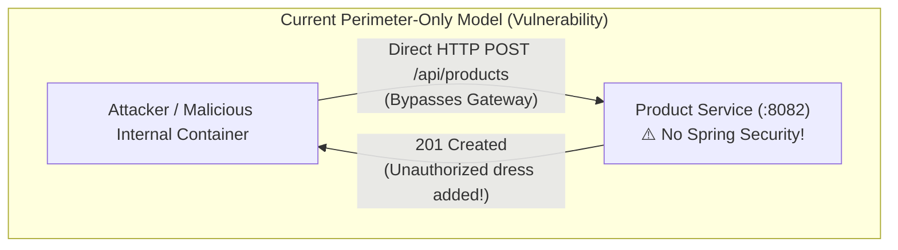
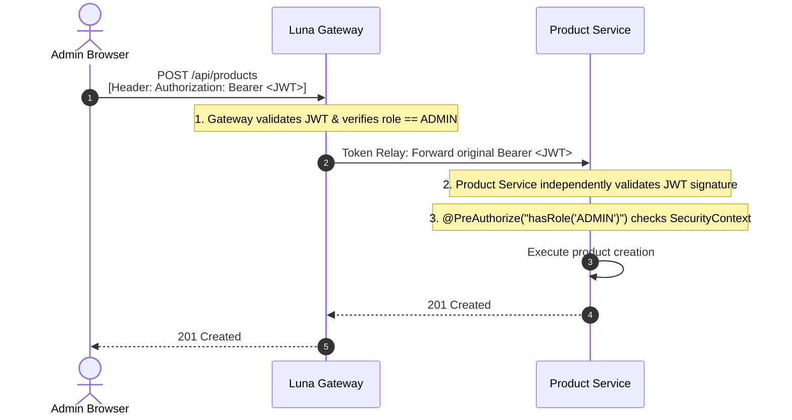
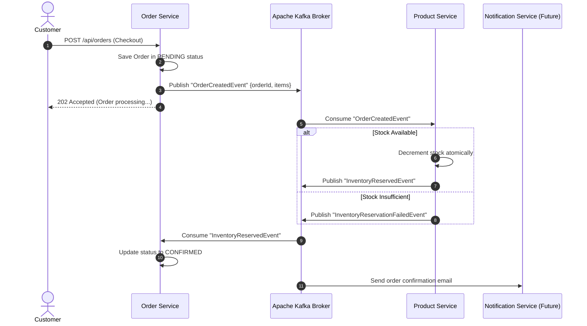
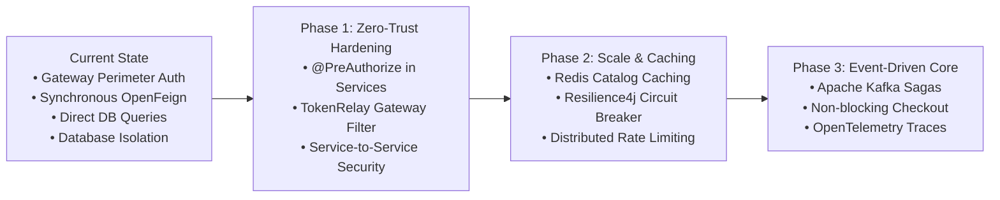

# Luna — Upcoming Improvements & Architecture Roadmap
## Enterprise Hardening, Zero-Trust Security, and Scalability Blueprint

---

### Executive Summary

This document outlines the **architectural evolutions and upcoming technical improvements** for the **Luna — Haute Couture Dress Shop E-Commerce Platform**. 

While Luna's current architecture successfully demonstrates fundamental microservices patterns (Database-per-Service, Gateway reverse proxying, OpenFeign synchronous communication, and immutable snapshots), this roadmap details the exact steps to elevate Luna from a functional microservices platform to a **fault-tolerant, Zero-Trust, enterprise-grade cloud ecosystem**.

---

## Roadmap Index & Priority Matrix

| # | Improvement Domain | Current Implementation Limitation | Target Enterprise Architecture | Priority |
|---|---|---|---|---|
| **1** | **In-Service Security & Zero-Trust** | Gateway-only perimeter auth; downstream services lack self-defense (`@PreAuthorize` missing). | Zero-Trust architecture: Spring Security in every service with `@PreAuthorize`, Token Relay, and mTLS. | **P0 (Immediate)** |
| **2** | **Event-Driven Messaging (Kafka)** | Synchronous OpenFeign calls during checkout tightly couple service availability. | Asynchronous Event-Driven Saga pattern using Apache Kafka / RabbitMQ. | **P1 (High)** |
| **3** | **Distributed Caching (Redis)** | Repeated catalog & category database reads increase latency and connection usage. | Distributed Redis caching (`@Cacheable`) with cache eviction and Redis rate-limiting at Gateway. | **P1 (High)** |
| **4** | **Resilience & Fault Tolerance** | No circuit breaker on inter-service calls; slow responses cause thread exhaustion. | Resilience4j Circuit Breakers, Retries with exponential backoff, and graceful fallbacks. | **P2 (Medium)** |
| **5** | **Distributed Observability** | Independent console logs make debugging multi-service transactions difficult. | OpenTelemetry + Micrometer Tracing + Zipkin/Grafana for end-to-end distributed trace tracking. | **P2 (Medium)** |
| **6** | **Search Engine Integration** | PostgreSQL `ILIKE %query%` Specifications query has $O(N)$ scan overhead on large catalogs. | Dedicated Elasticsearch / Meilisearch index with typo tolerance and faceted search. | **P3 (Future)** |

---

## 1. Zero-Trust Security & In-Service Authorization (`@PreAuthorize`)

### 1.1 Current Implementation & Identified Risks

In the current version of Luna:
1. **Perimeter-Only Security**: `luna-gateway` validates the JWT and checks if `role == 'ADMIN'` for write operations.
2. **Naked Downstream Services**: `product-service` and `order-service` do not include Spring Security. They trust that incoming requests from the internal network are legitimate and rely on injected HTTP headers (`X-User-Role`, `X-User-Id`).



#### Key Vulnerabilities of the Current Approach:
* **Gateway Bypass Vulnerability**: If port `8082` is ever exposed (misconfigured Docker port mapping, internal network breach, or SSRF exploit), anyone can perform administrative actions (`POST/PUT/DELETE /api/products`) without any authentication.
* **Header Spoofing**: An attacker sending `X-User-Role: ADMIN` directly to downstream services can trick services that rely purely on plain headers.
* **Coarse-Grained Authorization**: The Gateway can only check route prefixes (e.g. `/api/admin/**`); it cannot perform domain-level business authorization (e.g., verifying if the user owns a specific resource before modifying it).

---

### 1.2 Target Architecture: Zero-Trust Defense-in-Depth

Under a **Zero-Trust** model (*"Never Trust, Always Verify"*), every single microservice is an independent, self-defending unit.



---

### 1.3 Why the Target Architecture Is Superior

1. **Self-Defending Services**: Even if the API Gateway is completely disabled, bypassed, or compromised, `product-service` will reject unauthorized requests with `401 Unauthorized` or `403 Forbidden`.
2. **Protection Against Header Spoofing**: Downstream services validate the **cryptographic HMAC-SHA256 signature** of the JWT token rather than trusting raw text headers.
3. **Fine-Grained Method-Level Security**: Enables granular annotations like:
   ```java
   // Only the customer who placed the order or an admin can access it
   @PreAuthorize("hasRole('ADMIN') or #userId.toString() == authentication.principal")
   public OrderResponse getOrderById(UUID orderId, UUID userId) { ... }
   ```

---

### 1.4 Technical Implementation Blueprint

#### Step A: Add Spring Security & JWT to `product-service/pom.xml`
```xml
<dependency>
    <groupId>org.springframework.boot</groupId>
    <artifactId>spring-boot-starter-security</artifactId>
</dependency>
<dependency>
    <groupId>io.jsonwebtoken</groupId>
    <artifactId>jjwt-api</artifactId>
    <version>0.12.6</version>
</dependency>
```

#### Step B: Configure Security & Method Security in `product-service`
```java
package com.luna.product.config;

import org.springframework.context.annotation.Bean;
import org.springframework.context.annotation.Configuration;
import org.springframework.http.HttpMethod;
import org.springframework.security.config.annotation.method.configuration.EnableMethodSecurity;
import org.springframework.security.config.annotation.web.builders.HttpSecurity;
import org.springframework.security.config.http.SessionCreationPolicy;
import org.springframework.security.web.SecurityFilterChain;
import org.springframework.security.web.authentication.UsernamePasswordAuthenticationFilter;

@Configuration
@EnableMethodSecurity(prePostEnabled = true) // <-- Enables @PreAuthorize
public class SecurityConfig {

    private final JwtAuthenticationFilter jwtFilter;

    public SecurityConfig(JwtAuthenticationFilter jwtFilter) {
        this.jwtFilter = jwtFilter;
    }

    @Bean
    public SecurityFilterChain securityFilterChain(HttpSecurity http) throws Exception {
        return http
            .csrf(csrf -> csrf.disable())
            .sessionManagement(sm -> sm.sessionCreationPolicy(SessionCreationPolicy.STATELESS))
            .authorizeHttpRequests(auth -> auth
                .requestMatchers(HttpMethod.GET, "/api/products/**", "/api/categories/**").permitAll()
                .requestMatchers("/actuator/**", "/swagger-ui/**", "/v3/api-docs/**").permitAll()
                .anyRequest().authenticated()
            )
            .addFilterBefore(jwtFilter, UsernamePasswordAuthenticationFilter.class)
            .build();
    }
}
```

#### Step C: Add `@PreAuthorize` to Administrative Controllers
In [`ProductController.java`](file:///Users/sanjaya/Documents/DressShoppingWebsite/product-service/src/main/java/com/luna/product/controller/ProductController.java):
```java
@PostMapping
@PreAuthorize("hasRole('ADMIN')") // <-- Self-defending endpoint
@Operation(summary = "Create product", description = "Admin-only endpoint to create a dress")
public ResponseEntity<ProductResponse> create(@Valid @RequestBody ProductRequest request) {
    return ResponseEntity.status(HttpStatus.CREATED).body(productService.create(request));
}

@PutMapping("/{id}")
@PreAuthorize("hasRole('ADMIN')")
public ResponseEntity<ProductResponse> update(@PathVariable UUID id, @Valid @RequestBody ProductRequest request) {
    return ResponseEntity.ok(productService.update(id, request));
}

@DeleteMapping("/{id}")
@PreAuthorize("hasRole('ADMIN')")
public ResponseEntity<Void> deactivate(@PathVariable UUID id) {
    productService.deactivate(id);
    return ResponseEntity.noContent().build();
}
```

#### Step D: Configure Gateway as a Token Relay
In [`luna-gateway/src/main/resources/application.properties`](file:///Users/sanjaya/Documents/DressShoppingWebsite/luna-gateway/src/main/resources/application.properties), ensure the `Authorization: Bearer <token>` header is relayed downstream:
```properties
spring.cloud.gateway.routes[1].id=product-service-route
spring.cloud.gateway.routes[1].uri=${PRODUCT_SERVICE_URL:http://localhost:8082}
spring.cloud.gateway.routes[1].predicates[0]=Path=/api/products/**,/api/categories/**
# Relays Authorization header downstream
spring.cloud.gateway.routes[1].filters[0]=TokenRelay=
```

#### Step E: Configure OpenFeign Token Relay (Service-to-Service)
In `order-service`, add a Feign `RequestInterceptor` so that background calls to `product-service` forward the user's security token:
```java
@Configuration
public class FeignClientConfig {
    @Bean
    public RequestInterceptor requestInterceptor() {
        return requestTemplate -> {
            ServletRequestAttributes attributes = (ServletRequestAttributes) RequestContextHolder.getRequestAttributes();
            if (attributes != null) {
                String authHeader = attributes.getRequest().getHeader("Authorization");
                if (authHeader != null) {
                    requestTemplate.header("Authorization", authHeader);
                }
            }
        };
    }
}
```

---

## 2. Asynchronous Event-Driven Architecture (Apache Kafka)

### 2.1 Current Limitation
Currently, `order-service` calls `product-service` synchronously via OpenFeign during checkout. 
* If `product-service` is slow or temporarily unavailable, checkout latency increases or fails completely.
* Temporal coupling: both services must be 100% operational at the exact same millisecond.

### 2.2 Target Architecture
Implement the **Choreographed Saga Pattern** using **Apache Kafka**:



---

## 3. Distributed Caching & Rate Limiting (Redis)

### 3.1 Current Limitation
Dress catalogs, categories, and variant lists are queried directly against PostgreSQL on every browse request. In high-traffic scenarios, this burdens database connection pools (such as Supabase's 15-connection limit).

### 3.2 Target Architecture
1. **Catalog Read Caching**: Integrate Spring Cache with Redis for high-frequency read endpoints:
   ```java
   @Cacheable(value = "products", key = "#id")
   public ProductDetailResponse getById(UUID id) { ... }

   @CacheEvict(value = "products", key = "#id")
   public ProductResponse update(UUID id, ProductRequest request) { ... }
   ```
2. **Distributed Rate Limiting at Gateway**: Replace in-memory rate limiting with Redis-backed Sliding-Window rate limiting to protect against Layer-7 DDoS and brute-force login attacks:
   ```properties
   spring.cloud.gateway.routes[0].filters[0]=RequestRateLimiter
   spring.redis.host=localhost
   spring.redis.port=6379
   ```

---

## 4. Resilience4j Circuit Breakers & Fault Tolerance

### 4.1 Current Limitation
If `product-service` crashes during high checkout loads, `order-service` threads hang until TCP timeout, causing thread pool exhaustion and cascading system failure.

### 4.2 Target Architecture
Wrap OpenFeign calls with **Resilience4j Circuit Breaker and Fallback**:

```java
@CircuitBreaker(name = "productService", fallbackMethod = "getVariantFallback")
@Retry(name = "productService")
public VariantDetailResponse getVariant(UUID variantId) {
    return productServiceClient.getVariant(variantId);
}

// Graceful fallback if Product Service is down
public VariantDetailResponse getVariantFallback(UUID variantId, Throwable t) {
    log.error("Product service unavailable for variant: {}", variantId, t);
    throw new ServiceUnavailableException("Product catalog temporarily busy. Please retry in a few moments.");
}
```

---

## 5. Distributed Observability (OpenTelemetry & Micrometer)

### 5.1 Current Limitation
When an order fails across Gateway $\rightarrow$ Order Service $\rightarrow$ Product Service, tracking the error requires manually correlating independent logs across 3 distinct services.

### 5.2 Target Architecture
* Introduce **Micrometer Tracing** with OpenTelemetry and Zipkin/Tempo.
* Every HTTP request entering `luna-gateway` receives a unique `traceId` (e.g., `traceId=a1b2c3d4e5f6`).
* The Gateway forwards this `traceId` in headers to all downstream services and Kafka events.
* Sentry or Grafana Tempo provides a single waterfall visual showing exact execution times and failures across all services.

---

## Summary: Architecture Evolution Roadmap



