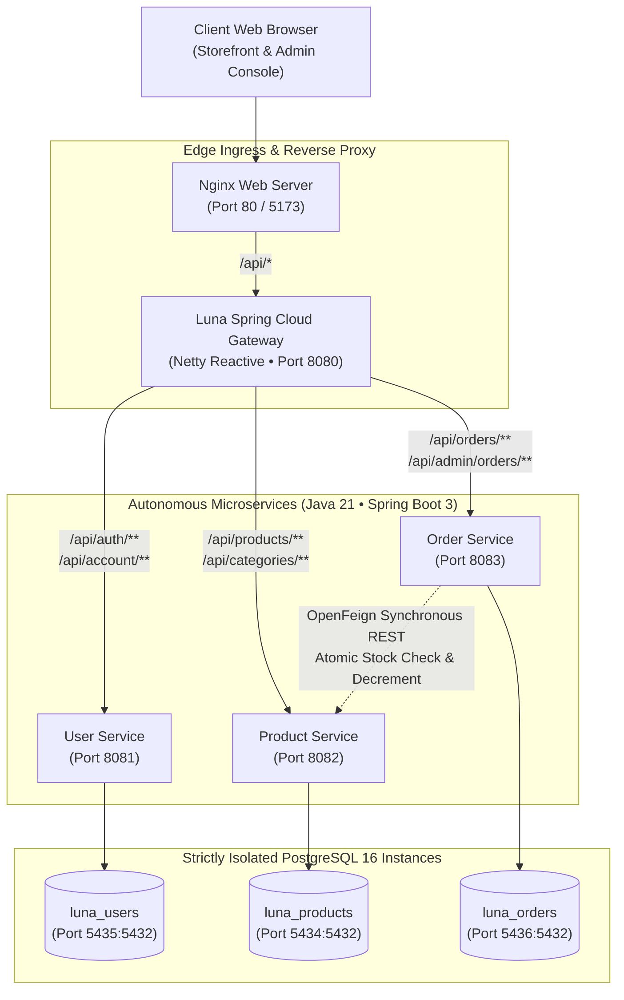

# L U N A — Haute Couture E-Commerce Microservices

[](https://openjdk.org/projects/jdk/21/)
[](https://spring.io/projects/spring-boot)
[](https://spring.io/projects/spring-cloud)
[](https://react.dev/)
[](https://tailwindcss.com/)
[](https://www.postgresql.org/)
[](https://www.docker.com/)

**Luna** is an enterprise-grade, distributed microservices platform powering an ultra-luxury bespoke dress boutique and atelier. The platform is designed around strict domain isolation, event-ready bounded contexts, resilient inter-service REST communications, atomic inventory decrement workflows, and an editorial, high-fashion storefront.

---

## 1. System Architecture



---

## 2. Core Architectural Principles

1. **Strict Database Isolation**:
   - Each microservice possesses exclusive ownership over its database (`luna_users`, `luna_products`, `luna_orders`). Direct cross-database joins, shared tables, or foreign keys between service schemas are strictly prohibited.
2. **OpenFeign Inter-Service Communication**:
   - `order-service` communicates with `product-service` via declarative Spring Cloud OpenFeign clients powered by Apache HttpClient 5 (supporting full `PATCH` semantics and custom error decoders).
3. **Atomic Concurrency & Inventory Protection**:
   - Stock decrements utilize atomic conditional SQL updates (`UPDATE product_variants SET stock_quantity = stock_quantity - :qty WHERE stock_quantity >= :qty`) preventing overselling and race conditions under high traffic.
4. **Immutable Snapshots**:
   - Order items store immutable historical copies of product name, unit price, size, and color snapshot at time of checkout, ensuring historic order records are permanently preserved even if catalog products are modified.
5. **Modern Java 21 Standards**:
   - DTOs and API payloads are defined as Java Records for immutability, pattern matching, and zero-boilerplate serialization. JPA entities are never leaked to external REST controllers.

---

## 3. Technology Stack

| Layer | Technologies |
|:------|:-------------|
| **Backend Core** | Java 21 (LTS), Spring Boot 3.3.4, Spring Data JPA, Hibernate 6 |
| **API Gateway** | Spring Cloud Gateway (Netty Non-Blocking Reactive WebFlux) |
| **Inter-Service REST** | Spring Cloud OpenFeign 2023.0.3, Apache HttpClient 5 |
| **Security & Auth** | Spring Security 6, JJWT (HMAC-SHA256 Token Signing), BCrypt |
| **Documentation** | SpringDoc OpenAPI 3, Swagger UI, RFC 7807 Problem Details |
| **Databases** | PostgreSQL 16 (Alpine), UUIDv4 (`pgcrypto`), B-Tree Indexing |
| **Frontend Storefront** | React 18, Vite 5, Tailwind CSS, Lucide Icons, Axios |
| **DevOps & Containers** | Multi-stage Dockerfiles (Alpine JRE 21), Docker Compose |

---

## 4. Port & Service Directory

| Service | Host Port | Internal Port | Primary Responsibility |
|:--------|:----------|:--------------|:-----------------------|
| `luna-gateway` | `8080` | `8080` | Unified API routing, CORS negotiation, edge security |
| `user-service` | `8081` | `8081` | Customer auth, JWT signing, profile & address management |
| `product-service` | `8082` | `8082` | Haute couture dress catalog, variants, categories, inventory |
| `order-service` | `8083` | `8083` | Order processing, stock reservation, status transitions |
| `frontend` | `80` / `5173` | `80` | React customer storefront, checkout flow, admin back-office |
| `postgres-products` | `5434` | `5432` | Catalog & inventory database (`luna_products`) |
| `postgres-users` | `5435` | `5432` | Identity & credentials database (`luna_users`) |
| `postgres-orders` | `5436` | `5432` | Orders, line items & billing database (`luna_orders`) |

---

## 5. Prerequisites

Before running the application, ensure the following are installed:
- **Java 21**: Verify with `java -version`
- **Apache Maven 3.9+**: Verify with `mvn -version`
- **Node.js 20+ & npm**: Verify with `node -v` and `npm -v`
- **Docker & Docker Compose**: Verify with `docker --version` and `docker compose version`
- **PostgreSQL 16** (Only required if running services standalone outside Docker)

---

## 6. Quickstart: Docker Compose (Recommended)

Launch the complete stack (3 isolated databases, 3 microservices, 1 gateway, 1 frontend SPA with Nginx, and automated schema migrations):

```bash
# 1. Clone repository
git clone https://github.com/your-org/DressShoppingWebsite.git
cd DressShoppingWebsite

# 2. Copy environment configuration
cp .env.example .env

# 3. Build containers and run detached
docker compose up --build -d

# 4. Stream service startup logs
docker compose logs -f
```

Once healthy:
- **Storefront & Admin**: `http://localhost` (or `http://localhost:5173`)
- **API Gateway**: `http://localhost:8080`

To tear down the containers:
```bash
docker compose down -v
```

---

## 7. Local Development Setup (Manual)

If developing individual services directly on the host machine:

### 1. Database Initialization
Ensure PostgreSQL is running locally on port `5433` (or update `.env`):
```sql
CREATE DATABASE luna_products;
CREATE DATABASE luna_users;
CREATE DATABASE luna_orders;
```
Execute the DDL and DML scripts in order:
```bash
psql -p 5433 -U postgres -d luna_products -f Luna-platform/db/ddls/1.\ products.sql
psql -p 5433 -U postgres -d luna_products -f Luna-platform/db/dmls/1.\ products-seed.sql
psql -p 5433 -U postgres -d luna_users -f Luna-platform/db/ddls/2.\ users.sql
psql -p 5433 -U postgres -d luna_users -f Luna-platform/db/dmls/2.\ users-seed.sql
psql -p 5433 -U postgres -d luna_orders -f Luna-platform/db/ddls/3.\ orders.sql
```

### 2. Compile Java Modules
From the root workspace directory:
```bash
mvn clean package -DskipTests
```

### 3. Start Backend Microservices (In Separate Terminals)
```bash
# Terminal 1: Product Service
cd product-service && mvn spring-boot:run

# Terminal 2: User Service
cd user-service && mvn spring-boot:run

# Terminal 3: Order Service
cd order-service && mvn spring-boot:run

# Terminal 4: API Gateway
cd luna-gateway && mvn spring-boot:run
```

### 4. Start React Storefront
```bash
cd frontend
npm install
npm run dev
```
Open [http://localhost:5173](http://localhost:5173) in your browser.

---

## 8. Default Seed Accounts

The platform includes pre-configured administrative and customer accounts:

| Role | Email | Password | Access Level |
|:-----|:------|:---------|:-------------|
| **Atelier Director** | `admin@luna.com` | `Password123!` | Full Admin Console (`/admin`), Product/Variant CRUD, Inventory Adjustments, Order Fulfillment Workflow |
| **VIP Customer** | `elena.rostova@example.com` | `Password123!` | Storefront Catalog, Shopping Bag, Instant Checkout with Saved NYC Address, Order Tracking & Cancellation |

---

## 9. Interactive API Documentation (Swagger UI)

Each service exposes OpenAPI 3 interactive documentation:

- **Product Service Swagger UI**: [http://localhost:8082/swagger-ui.html](http://localhost:8082/swagger-ui.html)
- **User Service Swagger UI**: [http://localhost:8081/swagger-ui.html](http://localhost:8081/swagger-ui.html)
- **Order Service Swagger UI**: [http://localhost:8083/swagger-ui.html](http://localhost:8083/swagger-ui.html)

---

## 10. Complete API Specifications Matrix

All 24 endpoints are formally documented in the `Luna-api-spec/` directory:

### Product Service (`/api/products`, `/api/categories`)
- [List Products & Filters](Luna-api-spec/product-service/list-products.md) (`GET /api/products`)
- [Get Product By ID](Luna-api-spec/product-service/get-product-by-id.md) (`GET /api/products/{id}`)
- [Get Variant By ID](Luna-api-spec/product-service/get-variant-by-id.md) (`GET /api/products/variants/{variantId}`)
- [Create Product (Admin)](Luna-api-spec/product-service/create-product.md) (`POST /api/products`)
- [Update Product (Admin)](Luna-api-spec/product-service/update-product.md) (`PUT /api/products/{id}`)
- [Delete Product (Admin)](Luna-api-spec/product-service/delete-product.md) (`DELETE /api/products/{id}`)
- [Add Product Variant (Admin)](Luna-api-spec/product-service/add-product-variant.md) (`POST /api/products/{id}/variants`)
- [Adjust Variant Stock](Luna-api-spec/product-service/adjust-variant-stock.md) (`PATCH /api/products/variants/{variantId}/stock`)
- [List Categories](Luna-api-spec/product-service/list-categories.md) (`GET /api/categories`)
- [Get Category By Slug](Luna-api-spec/product-service/get-category-by-slug.md) (`GET /api/categories/{slug}`)

### User Service (`/api/auth`, `/api/account`)
- [Register Customer](Luna-api-spec/user-service/register-customer.md) (`POST /api/auth/register`)
- [Login / Authenticate](Luna-api-spec/user-service/login-authenticate.md) (`POST /api/auth/login`)
- [Get Customer Profile](Luna-api-spec/user-service/get-account-profile.md) (`GET /api/account`)
- [Update Customer Profile](Luna-api-spec/user-service/update-account-profile.md) (`PUT /api/account`)
- [List Saved Addresses](Luna-api-spec/user-service/list-saved-addresses.md) (`GET /api/account/addresses`)
- [Add Delivery Address](Luna-api-spec/user-service/add-delivery-address.md) (`POST /api/account/addresses`)
- [Delete Delivery Address](Luna-api-spec/user-service/delete-delivery-address.md) (`DELETE /api/account/addresses/{id}`)
- [Get User By ID (Internal)](Luna-api-spec/user-service/get-user-by-id.md) (`GET /api/users/{id}`)

### Order Service (`/api/orders`, `/api/admin/orders`)
- [Place Customer Order](Luna-api-spec/order-service/place-order.md) (`POST /api/orders`)
- [List Customer Orders](Luna-api-spec/order-service/list-my-orders.md) (`GET /api/orders`)
- [Get Order By ID](Luna-api-spec/order-service/get-order-by-id.md) (`GET /api/orders/{id}`)
- [Cancel Order & Replenish Stock](Luna-api-spec/order-service/cancel-order.md) (`PATCH /api/orders/{id}/cancel`)
- [List All Orders (Admin)](Luna-api-spec/order-service/admin-list-orders.md) (`GET /api/admin/orders`)
- [Update Order Status (Admin)](Luna-api-spec/order-service/admin-update-order-status.md) (`PATCH /api/admin/orders/{id}/status`)

---

## 11. Directory Structure

```
DressShoppingWebsite/
├── pom.xml                               # Root Maven Parent POM
├── docker-compose.yml                    # Multi-container stack definition
├── .env.example                          # Environment variable template
├── README.md                             # Complete project documentation
├── GEMINI.md                             # Antigravity architectural guidelines
│
├── Luna-plan/                            # Architecture roadmaps and plans
│   ├── system-architecture.md
│   └── step-by-step-implementation.md
│
├── Luna-api-spec/                        # 24 Formal API specifications
│   ├── product-service/
│   ├── user-service/
│   └── order-service/
│
├── Luna-platform/                        # Database scripts and standards
│   └── db/
│       ├── ddls/                         # 1. products.sql, 2. users.sql, 3. orders.sql
│       └── dmls/                         # 1. products-seed.sql, 2. users-seed.sql
│
├── luna-gateway/                         # Spring Cloud Gateway (Port 8080)
│   ├── Dockerfile
│   └── src/main/java/com/luna/gateway/
│
├── product-service/                      # Product Catalog Microservice (Port 8082)
│   ├── Dockerfile
│   └── src/main/java/com/luna/product/
│
├── user-service/                         # Customer & Identity Microservice (Port 8081)
│   ├── Dockerfile
│   └── src/main/java/com/luna/user/
│
├── order-service/                        # Order & Fulfillment Microservice (Port 8083)
│   ├── Dockerfile
│   └── src/main/java/com/luna/order/
│
└── frontend/                             # React Storefront & Admin SPA
    ├── Dockerfile
    ├── nginx.conf                        # Production Nginx reverse proxy
    ├── index.html
    └── src/
        ├── components/                   # Navbar, Footer, CartDrawer, ProductCard...
        ├── context/                      # AuthContext, CartContext
        ├── layouts/                      # CustomerLayout, AdminLayout
        ├── pages/                        # Home, Products, Cart, Checkout, MyOrders...
        │   └── admin/                    # Dashboard, Products, Orders
        └── services/api.js               # Centralized Axios client
```

---

## 12. License & Atelier Attributions

Architected with pride for **Luna Haute Couture**. All designs, silhouettes, and typography specifications adhere to European haute couture boutique digital standards.
# Luna--dress-shopping-website-
